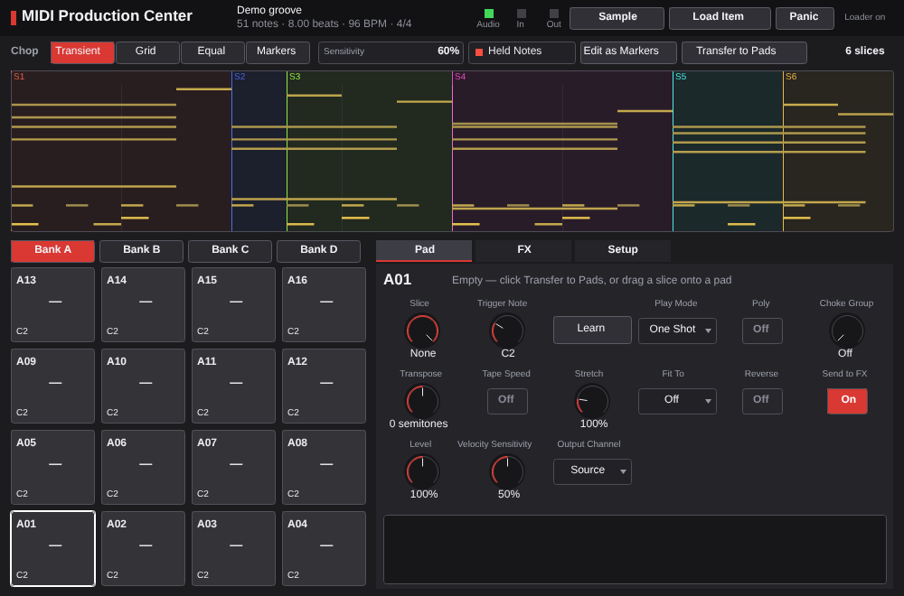

# MIDI Production Center for Ableton Live

A Max for Live MIDI effect. It is `MIDI_Production_Center.jsfx` and its three `.jsfx-inc` files, unchanged, running on Middaw's EEL2 runtime, with its own window: a MIDI phrase chopped onto sixteen pads and played like an MPC.

## Installing

Needs **Live 12.1 or later with Max for Live** (Live Suite, or Standard with
the add-on): the device runs on Max 9's JavaScript engine (`[v8ui]`).

1. Copy `MIDI Production Center.amxd`, `MIDIProductionCenter.js` and `MIDIProductionCenter.maxpat` into one folder, for
   example `Music/Ableton/User Library/Presets/MIDI Effects/Max MIDI Effect/`. The `.amxd` finds
   `MIDIProductionCenter.js` beside it.
2. Drag `MIDI Production Center.amxd` onto a MIDI track, in front of an instrument.
3. Optional: open it in the Max editor and click **Freeze Device**, then save.
   The device then carries the script inside it and can be moved on its own.

## Using it

| | |
| --- | --- |
| **Load Clip** | Chops the clip open in Detail View onto the pads, as "MPC - Load selected MIDI item" does with a REAPER item: its selected notes if any are selected, else its loop. |
| **Show Window** | Opens MIDI Production Center's own window, the one REAPER shows. Its **Load Item** works too: the device answers it as the background loader does, so "Loader on" shows without running anything. |

Everything MIDI Production Center saves in REAPER (its @serialize: the phrase, the pads, the effects) is saved with the Live set.

## How it is built

`ableton/device.json` describes the device; `python3 ableton/kit/build.py
ableton/device.json` writes the `.amxd`, the `.maxpat` and the script bundle
`MIDIProductionCenter.js`. The bundle is Middaw's EEL2 runtime, the plug-in and its includes from `Effects/MIDI Production Center/`, the shared window (`ableton/kit/jsfx_device.js`, `gfx.js`) and `ableton/actions.js`, the loaders' part. See `ableton/kit/VENDORED.md`.

`node --test ableton/tests/test_device.js` runs the device on a pretend Max and Live: the window draws and answers clicks all over it, notes go through and end, Load Clip and the window's own Load each chop a clip onto the pads through the loader's mailbox, a missing clip is reported to the window, and the state is saved and comes back. `node ableton/kit/test/shot.js ableton/MIDIProductionCenter.js 1000 660 out.png` draws the window.

## Limits

- **It has not been opened in Live yet.** It is tested in Node against a stand-in for Max and the Live Object Model; nothing has run in Max. If the `.amxd` will not open, open `MIDIProductionCenter.maxpat` in Max and save it as a device.
- MIDI goes in and out on Max's JavaScript clock, every 4 ms, not on the audio thread: up to a few milliseconds late, which an arc of CC or a held chord does not show but a tight rhythm may.
- Its controls are not Live parameters, so they cannot be automated or mapped; they are saved with the set.
- Markers come from REAPER take markers in the loader; a Live clip has none to give, so Markers chopping starts empty.
